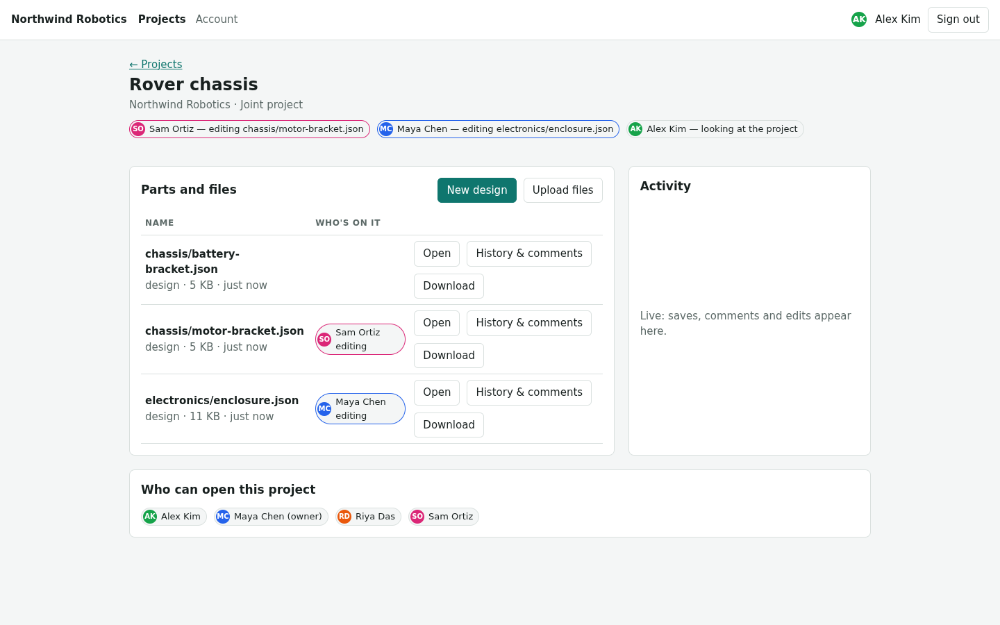
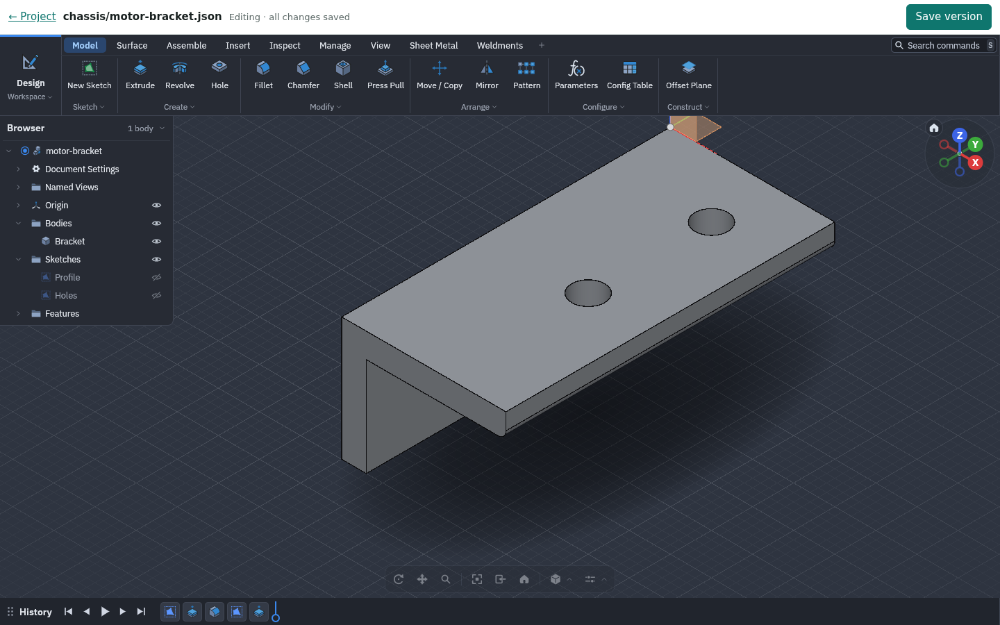
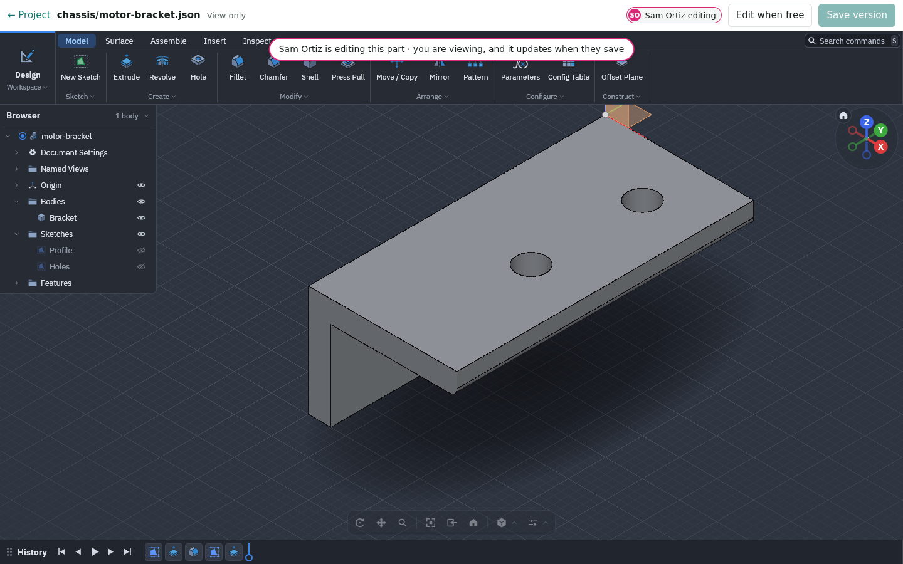
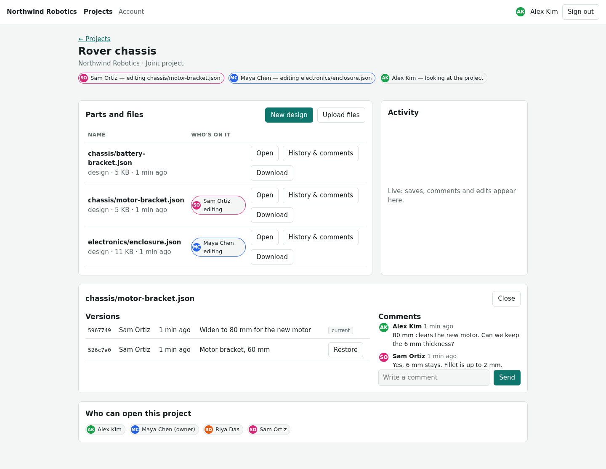
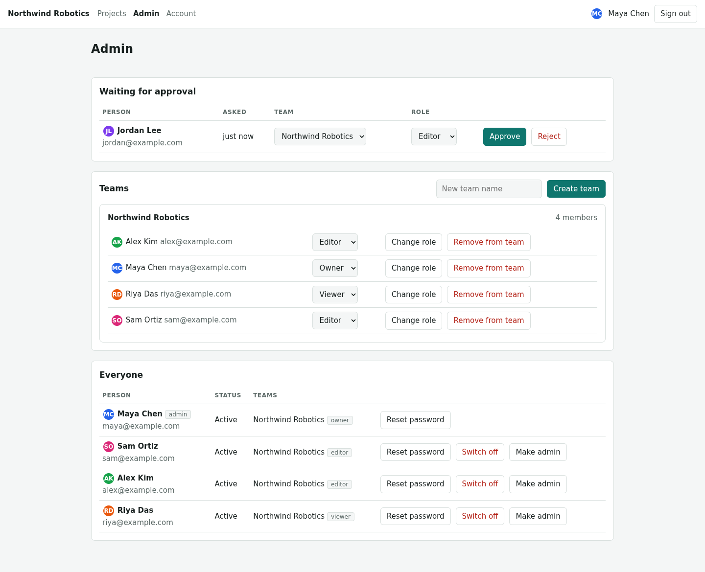

# solidcraft-collab

A multi-user add-on for [SolidCraft](https://github.com/tangency-labs/solidcraft): small teams
work on the same projects from their browsers, each person on their own part at the same time,
and everyone sees who is working where.



| | |
|---|---|
|  |  |
|  |  |

*A made-up team. SolidCraft runs unchanged inside the editor page.*

- **Accounts approved by an admin.** People sign up with any email and a password; an admin
  approves them into a team with a role (owner, editor, viewer). No outside identity provider or
  mail service. Passwords are argon2id hashes; sessions are HTTP-only cookies; sign-in is
  rate-limited.
- **Teams and projects.** Personal projects (owner only, shareable) and joint projects (the
  team). Teams never see each other's projects; the API answers 404 for them.
- **Versions.** Each project is a git repository. Every save is a version with its author;
  any version can be read or restored.
- **Per-part edit locks.** Each file has its own lock, so different people edit different parts
  of one project at once. Locks free themselves after 3 minutes without a heartbeat; project or
  team owners can free one.
- **Live presence.** A WebSocket per project carries who is in which file, whether they are
  editing or viewing, what they are working on, and save/comment events.
- **SolidCraft unchanged.** The editor page runs a stock SolidCraft browser build in
  `?embed=editor` mode, served from the same origin, and opens and saves designs through the
  documented browser API (`document.import`, `document.export`, `document.saved`).
- **CAD uploads.** With `COLLAB_CLI` set to a `solidcraft-cli`, an uploaded STEP/IGES (or any
  format that CLI reads) gets a design made from it.

## Run

```sh
cargo build --release
export COLLAB_DATA_DIR=/srv/collab COLLAB_APP_DIR=/path/to/solidcraft-web COLLAB_CLI=/path/to/solidcraft-cli
./target/release/solidcraft-collab create-admin you@example.com "Your Name" --temp-password
./target/release/solidcraft-collab serve        # http://127.0.0.1:8710
```

| Variable | Default | Meaning |
|---|---|---|
| `COLLAB_DATA_DIR` | `./collab-data` | database and project folders |
| `COLLAB_BIND` | `127.0.0.1:8710` | listen address (keep it on loopback; put HTTPS in front) |
| `COLLAB_APP_DIR` | none | SolidCraft browser build, served at `/app/` |
| `COLLAB_CLI` | none | `solidcraft-cli` used to turn uploaded CAD files into designs |
| `COLLAB_SITE_NAME` | `SolidCraft Collab` | name in the header |
| `COLLAB_PUBLIC_ORIGIN` | none | the public address, e.g. `https://team.example.com`; live connections from any other origin are refused |
| `COLLAB_SECURE_COOKIES` | `true` | Secure `__Host-` cookie; set `false` only for plain-HTTP local testing |
| `COLLAB_TRUST_CF_IP` | `false` | use Cloudflare's `CF-Connecting-IP` for per-address sign-in limits; set `true` only when the server is reachable solely through Cloudflare |
| `COLLAB_CONVERT_SANDBOX` | `systemd` | run conversions in a locked-down `systemd-run --user` unit (`none` = plain child process; not recommended) |
| `COLLAB_CONVERT_MEMORY_MB` | `1500` | memory cap per conversion |
| `COLLAB_PROJECT_QUOTA_MB` | `2048` | largest project folder, history included |
| `COLLAB_APP_CSP` | on | `off` removes the Content-Security-Policy from the SolidCraft app entirely |
| `COLLAB_LOCK_STALE_SECS` | `180` | seconds before an idle lock frees itself |
| `COLLAB_MAX_BODY_MB` | `64` | largest upload or save |
| `COLLAB_STATIC_DIR` | `./static` | the web pages |

Requires `git` on the server.

## Security notes

- **Behind a proxy**, set `COLLAB_TRUST_CF_IP=true` only if every request comes through
  Cloudflare; otherwise all clients share one sign-in rate-limit bucket (a warning is logged).
- **Conversion sandbox** needs a user systemd instance (`loginctl enable-linger <user>`) and a
  recent systemd (tested on systemd 259 / Ubuntu 26.04). Each conversion runs with no network,
  no Unix sockets (the user's systemd and D-Bus are unreachable), a memory cap without swap, one
  CPU, a time limit, a system-call filter and its own user namespace. Running the server and
  conversions under their own system users is still recommended.
- **Admins see every project**, personal ones included.
- **After replacing the SolidCraft build, restart the service**: the app's CSP pins the hashes of
  its inline scripts, read at start-up.
- Every state-changing API call needs an `X-Collab` header (CSRF guard); pages and scripts are
  same-origin only (strict CSP, no inline scripts).

## Limits (v0.1)

- Two people inside the same part at the same time is not supported yet; the second person views
  live and takes over when the part is free.
- An assembly that links other part files keeps those links as paths; the editor opens the
  assembly document itself, not its linked files.
- "What they are working on" is read from SolidCraft's UI state (open dialog or selection) and is
  best effort.

## Tests

`cargo test` runs the API end to end: approval, team isolation, roles, locks, versions, unsafe
paths and rate limiting.

## Licence

MIT OR Apache-2.0, like SolidCraft.
